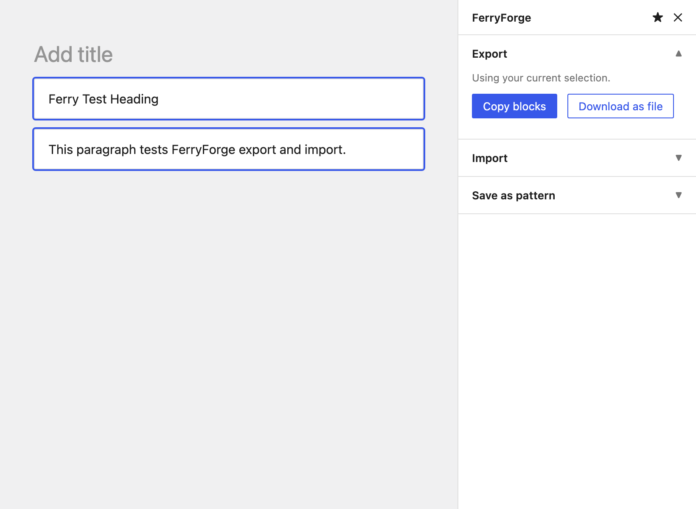

# Ferry Forge

  
  
  
  
  
  

  <b>Move blocks between WordPress sites.</b> 
  Export a selection or a whole post, import it anywhere, and save selections as synced patterns, all from the editor sidebar.

---

## Why it exists

Native copy and paste only works when both editors are open in the same browser at the same moment. The instant you need to send a layout to a client, move it between two sites you can't have open together, or keep a copy for next month, the clipboard is no help.

Ferry Forge gives you a **file** instead. Export the blocks you want, send or save the file, import it on the other end whenever you're ready. It uses standard WordPress block markup, so the export pastes cleanly into any editor even if the plugin isn't installed there.

That's the difference from a plain reusable block or a clipboard copy: the layout becomes something you can hand off, archive, and reuse across sites, not something trapped in one browser session. No accounts, no external service, no settings page. Everything happens right in the editor.

## Features

| | |
|---|---|
| **Export** | Copy the selected blocks (or the whole post) to your clipboard, or download them as a file. |
| **Import** | Paste block markup or load an exported file, and the blocks drop straight into the post you're editing. |
| **Save as pattern** | Turn any selection into a synced pattern you can reuse across the site. |
| **Portable format** | Exports are plain block markup, readable by any WordPress editor. |
| **Zero setup** | Runs on the editor's own scripts, no build step, no configuration. |

## Installation

**From your dashboard**

1. Download this repository as a ZIP.
2. Go to **Plugins → Add New → Upload Plugin** and pick the ZIP.
3. Activate it.

**Manually**

1. Copy the `ferryforge` folder into `wp-content/plugins/`.
2. Activate **Ferry Forge** on the Plugins screen.

Then open any post or page and look for the Ferry Forge icon in the top-right of the editor.

## How to use it

### Export

1. Select the blocks you want. Leave nothing selected to grab every top-level block in the post.
2. Open the **Ferry Forge** sidebar (the migrate icon, or the ⋮ menu → Ferry Forge).
3. Under **Export**, choose:
   - **Copy blocks** to put them on your clipboard, ready to paste into any editor.
   - **Download as file** to save an `.html` file you can import later or share.

### Import

1. Click into the spot where the blocks should land.
2. Under **Import**, either paste block markup into the box and hit **Add blocks**, or load a file you exported earlier.
3. The blocks appear in the post.

### Save as pattern

1. Select the blocks you want to keep.
2. Under **Save as pattern**, give it a name and click **Save synced pattern**.
3. It shows up in the pattern inserter (the **+** button → **Patterns**), ready to reuse.

## Screenshot

## How the portable format works

The export is the same block markup WordPress writes to the database, the `<!-- wp:... -->` comments you'd see in the code editor. That's deliberate: it means an exported file is not locked to this plugin. You can open it, copy the contents, and paste them into a plain block editor and they'll rebuild correctly. Ferry Forge just makes that a click instead of a copy-and-paste dance.

## Frequently asked questions

**Where is it in the editor?**
Top-right toolbar icon, or the ⋮ options menu → Ferry Forge. The sidebar has Export, Import, and Save as pattern sections.

**What gets exported when nothing is selected?**
Every top-level block in the post. Select specific blocks first if you only want part of it.

**Can I import into a site that doesn't have Ferry Forge?**
Yes. Open the exported file, copy everything, and paste it into any block editor. The import panel just saves you that step.

**Does it send my content anywhere?**
No. Copy, download, and import all run in your browser. Saving a pattern uses your own site's REST API, exactly like the editor already does.

## Requirements

- WordPress 6.3 or newer
- PHP 7.4 or newer

## Changelog

The full changelog lives in [`readme.txt`](readme.txt). Recent releases:

### 1.1.1
- Tested and confirmed compatible with WordPress 7.1.4.

### 1.1.0
- New: an "Also import images into this site" option in the Import panel. When you bring blocks in from another site, Ferry Forge can copy any external images into your own media library and update the links, so the layout no longer depends on the site it came from.

### 1.0.1
- Display name is now "Ferry Forge".

### 1.0.0
- First release.
- Export selected blocks, or the whole post, to the clipboard or a downloadable file.
- Import blocks from a file or pasted markup straight into the post you are editing.
- Save a selection as a synced pattern.

## Support

If Ferry Forge saves you some time, you can [buy me a coffee on Ko-fi](https://ko-fi.com/gunjanjaswal). It genuinely helps.

Found a bug or have an idea? Open an issue, or email me at [hello@gunjanjaswal.me](mailto:hello@gunjanjaswal.me).

## Author

**Gunjan Jaswal**

- Website: [gunjanjaswal.me](https://gunjanjaswal.me)
- Email: [hello@gunjanjaswal.me](mailto:hello@gunjanjaswal.me)
- Ko-fi: [ko-fi.com/gunjanjaswal](https://ko-fi.com/gunjanjaswal)

## License

Released under the [GPLv2 or later](https://www.gnu.org/licenses/gpl-2.0.html).
